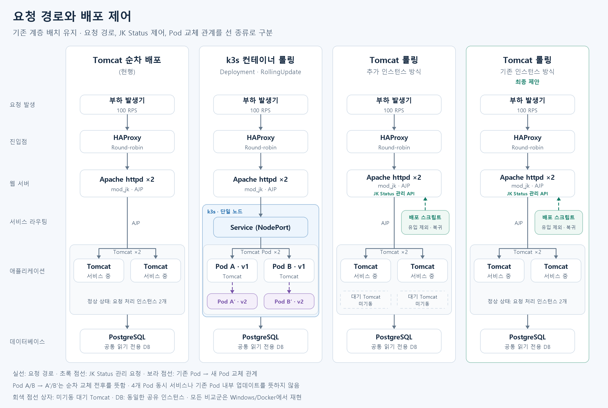
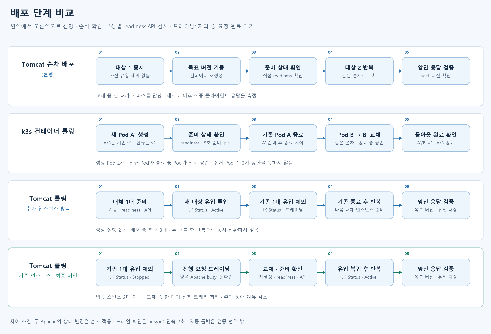
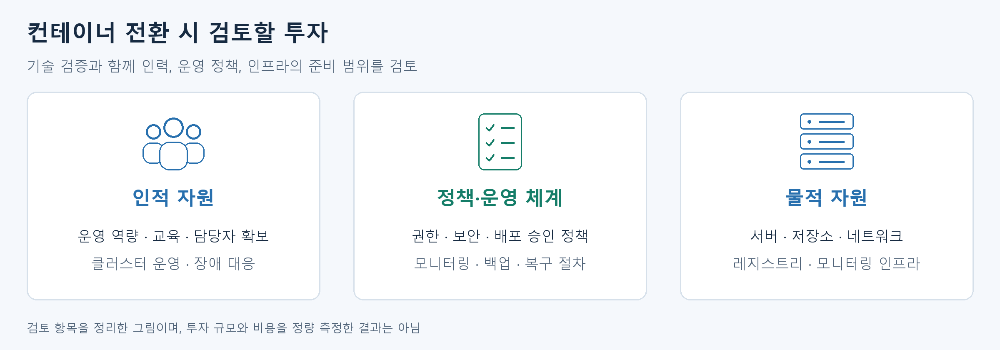

# Tomcat 무중단 배포 개선 — k3s 비교와 롤링 전환 검증

Tomcat 두 대를 이중화하고, 소스 배포 후 한 대씩 재기동하는 구성을 비교 기준 환경으로 구축했다. **레거시를 컨테이너 기반 배포로 전환하기 위한 PoC**로 시작해, k3s 도입과 기존 Tomcat의 배포 절차 개선을 함께 비교했다.

네 구성을 같은 부하에서 각각 10회 배포했다. 그 결과, **기존 서버에 유입 제어·드레이닝·준비 확인을 추가하는 방식도 실험의 응답 기준을 만족했다.** 컨테이너 전환에 필요한 투자와 리스크를 고려해, 가장 단순한 개선부터 적용하는 방향을 제안한다.

## 비교한 배포 방식

| 방식 | 교체 순서 | 인스턴스 운용 |
|---|---|---|
| **Tomcat 순차 배포(현행)** | 사전 유입 제외 없이 중지 → 교체 → 준비 확인 | 기존 2대, 교체 중 서비스 용량 감소 |
| **k3s 컨테이너 롤링** | 새 Pod 생성 → 준비 확인 → 기존 Pod 종료 | 정상 2개, 신규·종료 중 Pod 일시 공존 |
| **Tomcat 롤링 — 추가 인스턴스 방식** | 대체 1대 준비·유입 투입 → 기존 1대 제외·드레이닝·종료 | 정상 2대, 대체용 2대 미기동, 배포 중 최대 3대 실행 |
| **Tomcat 롤링 — 기존 인스턴스 방식** | 기존 1대 유입 제외·드레이닝 → 교체·준비 확인 → 복귀 | 기존 2대, 교체 중 1대가 전체 요청 처리 |



Tomcat 개선안은 두 Apache의 **JK Status**로 worker를 Stopped/Active로 변경한다. 유입 제외 후 처리 중 요청이 끝났는지 확인하고, 목표 버전의 준비·API 확인 후 복귀시킨다. k3s는 Deployment의 RollingUpdate와 readiness로 새 Pod를 투입한다. maxUnavailable=0, maxSurge=1이며 종료 중 Pod까지 포함한 전체 수가 항상 3개 이하라는 뜻은 아니다.

<details>
<summary>배포 단계 비교</summary>



두 Apache의 상태 변경은 순차 적용이다. JK Status 드레인은 대상 제외와 busy=0을 연속 2초 확인한다. Pod A/B와 A′/B′는 교체 전후를 설명하는 이름이며, 기존 Pod를 내부 수정하는 방식이 아니다. DB는 네 실험이 공유하는 동일 인스턴스다.

</details>

## 실험과 결과

2026-10-17 · 100 RPS · 구성별 10회. 같은 WAR·Java/Tomcat·API 인증·읽기 전용 PostgreSQL을 사용했다. API는 DB 조회 후 대기를 포함해 약 100ms 처리시간을 만들며, 실제 업무의 CPU·DB 부하를 재현하는 용도는 아니다.

예열 5초 → 기준 5초 → 실제 배포 → 후속 5초 순서로 측정했다. 비측정 앱은 중지하고, 네 환경의 실행 순서를 4회 묶음마다 균형화했다. 요청은 응답 본문 완료까지 측정하며, 미발송·지연·실패를 구분하고 불리한 회차를 대체하지 않았다.

| 방식 | 배포시간 중앙값 | 성공 응답 p99 | API 실패 | 300ms 초과 성공 |
|---|---:|---:|---:|---:|
| Tomcat 순차 배포(현행) | 18.18초 | 1,281.29ms | 0 | 2,752건 (15.13%) |
| k3s 컨테이너 롤링 | 34.55초 | 107.49ms | 0 | 0 |
| Tomcat 롤링 — 추가 인스턴스 방식 | 39.25초 | 108.61ms | 0 | 0 |
| **Tomcat 롤링 — 기존 인스턴스 방식** | **39.97초** | **107.98ms** | **0** | **0** |

**40회 모두 완료·유효했고 미발송은 0건이었다.** 표는 배포 중 발송한 요청 기준이며, p99는 성공 요청 원본을 합쳐 재계산했다. 배포시간은 호출부터 기존 인스턴스 종료·목표 버전 준비 등 각 방식의 완료 검증까지다. 본문 완료 기준 클라이언트 제한은 30초, 자동 클라이언트 재시도는 없으며 mod_jk 내부 failover는 허용한다.

현행도 API 실패는 없었지만 배포 중 지연이 반복됐다. **요청을 처리하던 Tomcat을 `kill -9`로 강제 종료하자, mod_jk가 같은 요청을 다른 Tomcat으로 다시 보내 응답을 받아냈다.** 강제 종료 실험 3회 모두 요청 ID로 로그를 따라가 보니, A에서 처리하기 시작한 요청이 B에서 완료됐다. 클라이언트는 한 번만 호출했고 HAProxy도 재시도하지 않았으므로, mod_jk가 요청을 다시 보낸 것이다. 일반 부하에서도 이처럼 처리를 시작한 뒤 다른 Tomcat으로 다시 전달된 요청이 13건 확인됐다.

JK Status로 먼저 유입을 제외하고 드레이닝한 3회에서는 기존 요청이 A에서 정상 완료됐다. 유입 제외 이후 새 요청 2,955건은 모두 B에서 완료됐고 A로 들어간 새 요청은 0건이었다. **failover에 의존해 최종 성공을 얻는 경로와, 유입을 제어해 기존 요청을 정상 완료시키는 경로를 구분해 재현했다.**

<details>
<summary>요청별 원인 검증 — 추가 진단 9회와 로그</summary>

2026-10-19, 별도 환경에서 정상 종료·재기동, SIGKILL, 유입 제외·드레이닝 후 종료를 각 3회 실행했다. 목표 100 RPS의 같은 조회 API를 사용하고 다음 로그를 요청 ID로 연결했다.

- **클라이언트**: 단일 호출·응답 본문 완료·결과·응답 인스턴스.
- **HAProxy**: 요청 ID·재시도·큐/응답 시간.
- **Apache**: 요청 ID·최초/최종 worker·오류 수·처리 시간.
- **Tomcat 진단 Valve**: 요청 BEGIN/END·인스턴스·동시 처리 수·서버 구간 시간.
- **제어 이벤트**: 종료 요청·종료 코드·JK Status 상태·busy=0 확인.

| 진단 시나리오 | 반복 | 일반 부하 발송 | API 실패 | 300ms 초과 성공 | 확인 결과 |
|---|---:|---:|---:|---:|---|
| 정상 종료·재기동 | 3 | 5,916 | 0 | 518 | 지연 중 202건 worker 변경, 290건 Tomcat 내부 측정 구간 >300ms, 26건은 두 표식으로 분류되지 않음 |
| 처리 중 SIGKILL | 3 | 3,436 | 0 | 967 | 지연 967건 모두 최초·최종 worker 변경, 일반 요청 13건은 A의 BEGIN 후 B에서 완료 |
| 유입 제외·드레이닝 후 종료 | 3 | 5,021 | 0 | 0 | 진행 중 요청 정상 완료 3/3, 제외 후 새 요청 2,955건 모두 잔여 인스턴스에서 완료 |

**동일 요청의 실제 추적 예시** (`probe-647250ea8ad947bc9d2245977b0a9dec`, A의 BEGIN 기준):

```text
+  0 ms  Tomcat A: BEGIN, 처리 중 요청 수 6
+497 ms  제어 스크립트: A에 SIGKILL 요청
+593 ms  Docker FinishedAt: A 종료, ExitCode=137
+687 ms  Tomcat B: 동일 요청 ID BEGIN
+788 ms  Tomcat B: END 200, 서버 처리 약 101ms
         Apache: first=tomcat1 → last=tomcat2, 최종 200
         HAProxy: 요청 1회, retries=0, queue_ms=0
         클라이언트: 호출 1회, 최종 200, 약 795ms
```

A가 종료되기 전에 BEGIN은 있었지만 END는 없고, 같은 ID가 B에서 완료됐다. 요청은 응답 시작 전 읽기 전용 GET이며, 클라이언트·HAProxy의 재시도가 아닌 **mod_jk의 worker 변경**이 기록됐다. 이는 [mod_jk의 retry/failover 동작](https://tomcat.apache.org/connectors-doc/reference/workers.html)과 일치한다.

추적용 probe는 A에서 처리 중인 요청을 확실히 잡기 위해 진단 Valve에서 2.5초 대기시켰다. probe는 위 일반 부하 건수·지연 집계에서 제외했다. 드레이닝 probe의 약 2.6초 응답은 의도한 대기이며 성능 지연으로 합산하지 않았다. 실제 전달 확인에는 [Apache의 최초·최종 worker 로그 항목](https://tomcat.apache.org/connectors-doc/reference/apache.html)을 사용했다.

정상 재기동의 지연은 모두 failover 때문은 아니었다. 290건은 Tomcat BEGIN~END 자체가 300ms를 넘었다. JVM·DB·스케줄링 등 그 구간 내부의 세부 원인과 나머지 26건은 확정하지 않는다. 또한 이 진단은 **기존 40회와 별도**이며, 과거 지연 2,752건을 소급 분류하거나 비중을 확정한 결과는 아니다. `kill -9`가 안전하다는 뜻도 아니다. 응답이 시작됐거나 재전송할 수 없는 요청, 쓰기·세션의 중복 처리는 별도 검증이 필요하다.

[진단 집계](evidence/failover-20261019/summary.json) · [요청별 분석](evidence/failover-20261019/analysis.json) · [추적 예시](evidence/failover-20261019/1-sigkill/analysis.json) · [요청·로그 원본](evidence/failover-20261019) · [계측·분석 코드](scripts/diagnose_failover.py)

```powershell
# 보존 로그를 읽어 원인 연결과 집계 재검증 — Docker 불필요
python -B scripts/verify_failover_evidence.py
# 같은 이미지가 있는 환경에서 별도 프로젝트·DB·키로 새 진단 9회 실행
python -B scripts/diagnose_failover.py run --count 3
```

진단만 실행한 9회이며 기존 40회 성적에는 합산하지 않았다. 사전 확인 1회씩도 본 진단과 분리했다. 실험 종료 후 새 진단 리소스만 정리하며 원래 PoC 구성은 변경하지 않는다.

</details>

세 개선안은 **실패 0·300ms 초과 0**을 모두 만족했다. 기존 인스턴스 방식은 배포시간이 길어졌지만, 추가 실행 인스턴스 없이 응답 기준을 만족했다. 작은 p99 차이로 개선안의 성능 순위를 매기지는 않는다.

## 최종 제안

**기존 Tomcat의 유입 제어를 보완하는 롤링부터 적용하고, 운영 효과를 확인하며 확장한다.**

컨테이너 전환을 검토한 PoC에서 기존 환경의 배포 절차 개선도 목표를 만족했다. 인적·정책적·물적 투자와 전환 리스크를 고려해, 지금 해결할 문제에 필요한 가장 단순한 안부터 검증한다. 아래는 투자 검토 항목이며, 비용을 정량 비교한 결과는 아니다.



**유입 제어 개선 → 운영 부하에서 효과 확인 → 필요에 따라 추가 인스턴스·k3s 전환 검토.** 컨테이너 전환은 후속 대안으로 유지한다.

### 적용 범위와 남은 검증

- **배포 절차 비교다.** 리눅스 환경의 운영 절차를 Windows/Docker에서 재현했으며, 모든 비교군이 컨테이너로 실행됐다. 비컨테이너 대비 컨테이너 성능을 측정한 결과가 아니다.
- **정상 버전 교체 시험이다.** 동일 WAR에 v1/v2 식별값만 바꿨다. 실제 코드·스키마 변경의 호환성이나 자동 롤백을 검증한 것은 아니다.
- **단일 PC의 합성 조회 부하다.** 앱별 1 CPU/1GiB 제한은 같지만 추가 인스턴스·종료 중 Pod·k3s 제어 서비스까지 총 자원량을 동일하게 맞추지는 않았다.
- **운영 무중단은 추가 검증이 필요하다.** 한 대가 전체 부하를 처리할 용량, 세션·쓰기·DB 호환성, 교체 중 추가 장애와 복구 절차를 확인해야 한다. 운영 도입 효과·비용 절감액을 주장하지 않는다.

## 구현과 Codex 활용

Java API, 인프라 설정, 배포 제어, 부하 발생기, 실시간 관측 화면을 구현했다. HTTP/AJP 프록시와 외부 API 측정기도 탐색 도구로 포함하며 정식 40회 비교에서는 제외했다.

| 구성 | 소스 |
|---|---|
| API — Java 21·Spring Boot·PostgreSQL | [Application.java](src/main/java/local/poc/Application.java), [pom.xml](pom.xml) |
| Apache·Tomcat·k3s 구성과 교체 제어 | [infra/](infra), [poc.py](scripts/poc.py), [variants.py](scripts/variants.py) |
| 부하·실시간 관측·반복 실험 | [load.py](scripts/load.py), [dashboard.py](scripts/dashboard.py), [web/](web), [compare.py](scripts/compare.py) |
| 외부 API 측정·리포트·검증 | [external.py](scripts/external.py), [compare_report.py](scripts/compare_report.py), [scripts/](scripts) |

**Codex로 구현·실행·집계를 자동화**하고, 비교 조건·설계 결정·결과 해석을 검토하며 수정했다. 회귀 검사와 실제 배포 데이터로 구현을 확인했다. 늦은 응답 수집과 Windows 파일 공유 경합을 보완하고, 전략 변경 후 새 조건으로 재측정했다. 코드 전체의 수동 검토나 모든 운영 장애 검증을 뜻하지는 않는다.

## 실행과 검증

Windows PowerShell, Python 3.10 이상, Docker Desktop Linux 엔진이 필요하다. Java/Maven 빌드는 Docker 안에서 수행한다. 초기 빌드에는 네트워크가 필요하며, k3s 컨테이너는 privileged로 실행하는 로컬 PoC 구성이다.

```powershell
.\start-all.ps1
# 기존 인스턴스 롤링 관측: http://127.0.0.1:18705/
.\stop-all.ps1
```

키·DB 비밀번호는 첫 실행 때 생성해 .runtime에 저장한다. 기존 프로젝트의 DB 볼륨이 남아 있다면 같은 자격증명이 필요하고, 두 복사본은 포트·컨테이너가 겹치므로 동시 실행하지 않는다. 정상 종료는 볼륨·결과를 삭제하지 않는다. 중단된 배포의 pending.json은 실제 유입·버전 상태를 확인할 때까지 보존한다.

<details>
<summary>화면 주소와 40회 재현 명령</summary>

| 방식 | Live 포트 | CLI 모드 |
|---|---:|---|
| k3s 컨테이너 롤링 | 18700 | k3s |
| Tomcat 순차 배포 | 18701 | legacy |
| Tomcat 롤링 — 추가 인스턴스 | 18704 | bluegreen |
| Tomcat 롤링 — 기존 인스턴스 | 18705 | rolling |
| HTTP / AJP 프록시 탐색 | 18702 / 18703 | http / ajp |
| 외부 API 측정 | 18706 | 별도 측정기 |

주소는 모두 http://127.0.0.1:포트/ 이다. bluegreen은 포트·기존 데이터 호환용 내부 이름이며 현재 전략은 추가 인스턴스를 한 대씩 준비하는 롤링이다.

```powershell
python scripts/compare.py --modes legacy k3s bluegreen rolling --count 10 --profile quick
# 아래 경로를 위 명령이 출력한 comparison 폴더로 바꾼다.
python scripts/compare_report.py 'results/생성된-comparison-폴더명' --output results/new-report.md
```

실제 배포 40회이며 보존된 실행은 환경 전환·복원까지 총 46.34분이었다. 새 결과는 results에 별도 보존한다. 비교 후 전체 시연 환경은 `.\start-all.ps1 -SkipBuild`로 다시 기동할 수 있다. standard 프로파일은 관찰 구간을 10/10/20초로 늘린다. 미완료 요청은 개별 30초 한도까지 수집하며 고정 30초 대기를 추가하지 않는다.

실측 Docker VM은 24 CPU·약 31GiB였다. 최소 요구 사양을 검증한 것은 아니다. 모든 기반 이미지·패키지를 digest로 고정하지 않았으므로 새 빌드의 이미지 ID·WAR 해시가 실측과 같다고 보장하지 않는다.

</details>

컨테이너를 새로 띄우지 않고 검사할 수 있다. 회귀 검사 37개가 통과했으며, 감사 스크립트는 보존된 40회·192,204건(배포 중 132,201건)의 원본 해시·집계·p99·측정 핵심 소스와 추가 진단 9회의 요청별 연결을 확인한다. 테스트는 임시 로컬 HTTP 서버를 사용하고, OpenSSL이 없으면 TLS 검사가 skip될 수 있다.

```powershell
python -B -m unittest discover -s scripts -p "test_*.py"
python -B scripts/verify_evidence.py
```

[집계 CSV](evidence/benchmark/summary.csv) · [프로토콜](evidence/benchmark/protocol.json) · [회차 요약](evidence/benchmark/runs.json) · [런타임·WAR 해시](evidence/benchmark/runtime.json) · [요청 원본 gzip](evidence/runs) · [원본 해시](evidence/benchmark/raw-index.json)

원본은 바이트 변경 없이 압축했다. .gitattributes는 개행 변환을 막고 SHA256SUMS.json은 저장소 파일 해시를 기록한다. 소스나 문서를 수정하면 해시 목록도 갱신해야 한다. 실험 데이터는 합성 데이터이며, 실행 시 생성되는 인증정보는 저장소에서 제외한다. GitHub Actions에서도 회귀 검사와 보존 증거 감사를 통과했다.

<details>
<summary>그림 원본과 재생성</summary>

[구성도 SVG](docs/assets/architecture-topology.svg) · [단계도 SVG](docs/assets/architecture-rollout.svg) · [투자 항목 SVG](docs/assets/container-adoption.svg)

```powershell
python -m pip install Pillow
python -B scripts/draw_architecture.py
python -B scripts/draw_decision.py
```

Windows 맑은 고딕 또는 Linux Noto Sans CJK 폰트를 사용한다. 새 결과의 차트 생성에는 matplotlib을 선택적으로 사용한다.

</details>
